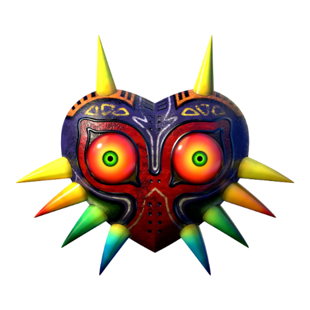

<div align="center">
  
  <h1>Majora Archive</h1>
  <p><strong>Every way to play <em>Majora's Mask</em>, in one archive.</strong></p>
  <p>A Termina-themed Windows launcher for open-source Zelda emulators and PC recomps.</p>
</div>

> **Pre-release.** `v0.3.0` is the current Windows build. The launcher is usable
> end to end, but expect rough edges while the public release takes shape.

Majora Archive gathers the open-source projects that run Zelda games into one
library. It downloads and updates the emulators and recomps, detects the game
files you already own, and puts every program's real settings and controller
bindings in one place — instead of sending you hunting through a dozen config
folders.

## What it does

- **One library.** Every supported title, every way to play it, with the
  versions you actually have installed marked ready.
- **Choose your build.** Pick the official release or a community fork for each
  emulator, side by side. Each build installs into its own folder, so trying
  Azahar Plus next to Azahar (or VBA-M next to mGBA) does not break either.
- **Settings without scavenger hunts.** The launcher edits each program's own
  config file: friendly controls for the settings people change most, the full
  key list for everything else, a raw editor, and **Restore backup** to undo a
  bad edit.
- **Controller bindings.** Keyboard capture for melonDS and mGBA, and text
  bindings for RetroArch, Dolphin, Ryujinx and Eden, all written to the
  emulator's real config.
- **Kept current.** Release feeds are checked for installed components, with
  checksum verification when the upstream project publishes one.
- **Cover art, music, and the small things.** Box art is fetched and cached
  locally; your own music can play over the archive. The Termina theme is part
  of the app.

## Download

Grab the latest installer from [Releases](../../releases/latest).

- Windows 10 / 11, x64
- Installer: `Majora-Archive-Setup-<version>.exe`
- Free and open source under GPL-3.0-or-later

The build is not code-signed yet, so Windows SmartScreen may show **Unknown
publisher** the first time. Choose **More info → Run anyway** if you trust the
build. Verify releases against the checksums published with them.

## What is not included

Majora Archive ships **no ROMs, disc images, encryption keys, firmware, BIOS
files or game assets**. Use copies you legally own. Switch emulation needs your
own keys and firmware; DS, 3DS and GBA emulation may need your own BIOS dumps.
The launcher links to each project's official releases and never bundles game
data.

## Supported components

| Area | Components |
| --- | --- |
| N64 recomps | Ship of Harkinian, 2 Ship 2 Harkinian, Zelda 64: Recompiled, TriAevum |
| Switch 2 | Triforce (used exactly as installed) |
| GameCube / Wii / Wii U | Dolphin, Cemu |
| DS / 3DS | melonDS, Azahar (and Azahar forks) |
| Game Boy / GBC / GBA | mGBA, SameBoy, VisualBoyAdvance-M |
| Switch | Ryujinx, Eden |
| Arcade / multi-system | MAME, ares, RetroArch |

Emulators and recomps belong to their communities and keep their own licences.
Majora Archive only downloads their published builds and drives their own
settings files.

## Build from source

Requirements: [Bun](https://bun.sh/) (tested with 1.4.2) and Windows for the
installer. No Node or npm install is needed.

```bash
bun install

bun run dev          # browser preview with mock data
bun run dev:desktop  # Vite + Electron together
bun run typecheck
bun run build
bun run dist         # typecheck + build + NSIS installer in release/
```

`bun run pack` produces an unpacked build in `release/win-unpacked` without the
installer. `bun run covers` refreshes the bundled cover cache tooling.

The browser preview uses `src/mock.ts`, so downloads and config writes are
simulated there. Use the desktop app to touch real files.

## Project layout

```text
electron/   Electron main process: detection, downloads, settings, updates
shared/     Catalog, component/build definitions, settings schemas
src/        React renderer, styles and UI
build/      Installer script and application icon
public/     Static assets shipped with the renderer
scripts/    Asset and cover helper scripts
```

The renderer never gets direct filesystem access. It talks to the main process
through a narrow preload bridge (`electron/preload.cjs`).

### How settings work

`shared/tunables.js` describes each program's real config file, its friendly
settings and its controller bindings. `electron/tunables.js` resolves the file,
parses INI, TOML, JSON or XML, and writes back only the value that changed,
leaving comments, ordering and unknown keys alone. Every write keeps the
previous version as `<file>.majora-backup`; **Restore backup** puts it back.

## Contributing

Issues and pull requests are welcome. Before opening a PR:

```bash
bun run typecheck
bun run build
```

Please do not attach ROMs, keys, firmware, BIOS files or other copyrighted game
data to issues or pull requests.

## Licence and credits

Majora Archive is released under the **GNU General Public License v3.0 or
later**. See [LICENSE](LICENSE).

- Developed by **RYFT**.
- Built around the approach and design language of the GPL-3.0 **Triforce**
  launcher. Triforce Setup itself is used exactly as installed.
- Bundled fonts: Cormorant Garamond and Commissioner, under the SIL Open Font
  License (see `src/assets/fonts`).
- All emulators and recomps remain the property of their respective authors and
  are distributed under their own licences.
- Box art is fetched at runtime from public community sources and cached
  locally.

Majora Archive is a fan project. It is not affiliated with, endorsed by, or
sponsored by Nintendo. *The Legend of Zelda*, *Majora's Mask* and related names
are trademarks of Nintendo.
